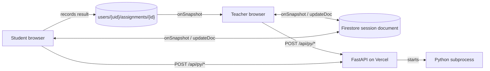

# PythonBit

PythonBit is my solo Final Year Project at Hong Kong Baptist University, supervised by Dr Martin Choy. It is a web platform for teaching Python to young learners moving from block-based tools to text-based code, with self-paced content and live classroom sessions.

Live site: https://python-bit-sigma.vercel.app

## Reviewers start here

- **Live session:** [`student-session-view.tsx`](components/session-views/student-session-view.tsx) and [`teacher-session-view.tsx`](components/session-views/teacher-session-view.tsx). Both listen to the same Firestore session document with `onSnapshot`. Students push their code to it, and the teacher reads that code and sends code back to one student or to all.
- **Code execution:** [`api/services/code_execution.py`](api/services/code_execution.py). Writes submitted code to a temporary file and runs it in a Python subprocess with a 5-second timeout, returning the output and an error flag.
- **Marking:** [`api/services/assignment_service.py`](api/services/assignment_service.py). Appends a comparison against an assignment's first example to the student's code, runs the result, and looks for a success marker in the output.

## Features

- **Live sessions:** the teacher picks a week and assignment, views a student's code, sends code to one student or everyone, and sees which online students have completed the task. Students share code with an Update Code button and on Submit, not on each keystroke.
- **Tutorials:** 11 MDX lessons with runnable code. Exercises for 7 of them are checked by the API.
- **Projects:** 5 themed projects. 2 have server-side checks configured.
- **Quizzes:** stored in Firestore, with attempts recorded per user.
- **Accounts and progress:** Firebase Authentication, a teacher or student role on the user document, and per-user progress for tutorials, projects, quizzes and assignments.

## Tech stack

Versions are from `package.json` and `requirements.txt`.

| Area | Technology |
| --- | --- |
| Frontend | Next.js 15.2.8 (App Router), React 19.1.0, TypeScript 5.8 |
| UI | Tailwind CSS 3.4, shadcn/ui on Radix UI |
| Code editor | CodeMirror 6 via `@uiw/react-codemirror` 4.23 |
| Content | MDX compiled with Velite |
| Client data | SWR, React Context for auth |
| Auth and database | Firebase 11: Authentication and Firestore |
| Code execution API | FastAPI 0.115.0, Uvicorn 0.30.6, SlowAPI |
| Hosting | Vercel |

## Architecture

There are two separate paths.

**Live state** goes between browsers and one Firestore document, `classrooms/{classroomId}/sessions/{sessionId}`. Browsers write to it directly and receive changes through `onSnapshot`, with no application server in between. Completion results are stored separately under each user, and the teacher's view listens to those documents too.

**Code** runs through FastAPI on Vercel. The browser posts code to `/api/py/*`, and the API starts a Python subprocess and returns its output. The API does not read or write Firestore. The browser records the result.



### Firestore collections

```
users/{uid}                  displayName, email, role, ...
  assignments/{id}           completed, lastAttempt, totalAttempts, successfulAttempts
    attempts/{id}            code, timestamp, success
  projects/{id}
  tutorials/{id}
  quizzes/{id}/attempts/{id}
classrooms/{id}              curriculumId, lastTaughtWeek, ...
  sessions/{id}              startedAt, endedAt, weekNumber, activeTask,
                             activeStudents[], students{uid: code, lastUpdated, ...}
curricula/{id}               weeks[]: weekNumber, title, assignmentIds[]
assignments/{id}             title, problemStatement, starterCode, examples[]
quizzes/{id}
```

## Getting started

Requires Node.js with npm, and Python 3 with pip3.

```bash
git clone https://github.com/ayazhankadessova/python-bit.git
cd python-bit
npm install
```

Create `.env.local`:

```env
NEXT_PUBLIC_FIREBASE_API_KEY=
NEXT_PUBLIC_FIREBASE_AUTH_DOMAIN=
NEXT_PUBLIC_FIREBASE_PROJECT_ID=
NEXT_PUBLIC_FIREBASE_STORAGE_BUCKET=
NEXT_PUBLIC_FIREBASE_MESSAGING_SENDER_ID=
NEXT_PUBLIC_FIREBASE_APP_ID=
NEXT_PUBLIC_ADMIN_EMAILS=
```

`NEXT_PUBLIC_ADMIN_EMAILS` is a comma-separated list of accounts that can open the `/firestore-stuff` admin pages.

```bash
npm run dev
```

This installs the Python requirements, then starts Next.js and FastAPI (on port 8000). Next.js forwards `/api/py/*` to FastAPI.

Firestore rules and indexes are not in this repo, so a new Firebase project needs its own. Curricula and assignments can be seeded from `/firestore-stuff/new-classroom`.

## How it evolved

From git history:

- **Sep 2024, `3f98046`:** Socket.IO added for a basic connection, with a custom `server.js`. Reason: [Ayazhan to add reason]
- **Nov 2024, `e1aadf5`:** MongoDB API routes and auth hooks removed for Firebase. Reason: [Ayazhan to add reason]
- **Apr 2025, `bd3194d`:** Socket.IO dependencies removed from `package.json`, along with the remaining `mongodb` dependency, as part of a version upgrade. Reason: [Ayazhan to add reason]

## Evaluation

There was no controlled study, so these results do not measure learning outcomes.

- Needs-finding survey: 30 questions, 17 respondents who were current or aspiring teachers
- 2 interviews
- 3 design iterations after usability testing
- Informal feedback from 2 teachers using it with 11-year-olds
- 10 registered accounts

The project report records averages of 1.2 s for initial page load and 0.3 s for subsequent navigation. These figures were not re-measured for this README.

## Known limitations and next steps

**Execution isolation and resource limits.** Submitted code runs as an ordinary subprocess with the same user, filesystem, network access and environment variables as the API process. The only resource limit is the 5-second timeout, with no cap on CPU, memory or output. `/api/py/*` does not check who the caller is, and CORS allows all origins. Next step: run code in a sandbox with no network or secrets, and require authentication.

**How marking decides success.** Assignments pass when stdout contains a fixed success marker. Student code and the check share one process and one output stream, so the result is not tamper-resistant. Only the first example is tested, although every configured assignment has more than one and the UI reports "All tests passed". Exercises compare output exactly or look for `True`, and projects look for a success string. The browser, not the server, writes the pass or fail result to Firestore. Assignment content also exists twice: browsers read Firestore and marking reads `config/assignment_configs.json`. Next step: run every example, return results through a separate channel from student output, and record results on the server.

**Shared session document and concurrent updates.** One document holds every student's code, so each write reaches every listener in the session, including classmates' browsers, and the document is subject to Firestore's per-document size limit. Session writes do not use transactions:

- Leaving a session rewrites `activeStudents` from the client's local copy, filtered by display name. A concurrent join or leave can be lost, and students sharing a name are removed together.
- Student and teacher writes to the same student's code are last-write-wins.
- Update Code replaces the student's whole entry, and joining a session resets it with empty code.
- Each snapshot copies the saved code into the student's local state. After any write to the document, Run and Submit can use the last saved code rather than what is on screen.

Next step: give each student their own document, and keep unsaved editor state out of the listener.

**In-memory rate limiter.** SlowAPI allows 10 requests per minute on `/execute` and 30 on the test endpoints. Counts are held in memory, so they are not shared between serverless instances and reset when an instance restarts. The key is the client address the server sees, so students on one school network could share a limit. Next step: use a shared store and limit per authenticated user.

**Access control.** Teacher, student and admin checks are in client code, and neither API layer verifies Firebase ID tokens. Firestore rules are not in this repo, so access control cannot be reviewed from the code. Next step: version the rules with the code.

**Test coverage.** There are no automated tests, no test runner and no CI configuration. Next step: start with unit tests for marking and code execution, then concurrent session updates.

## Credits

Python tutorial content adapted from:

- https://www.learnpython.org/en/Welcome
- https://www.geeksforgeeks.org/python-for-kids/#control
